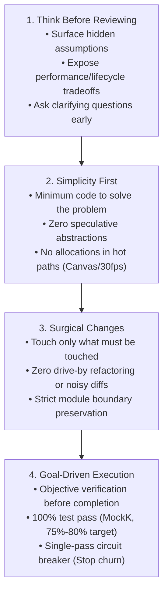

# Simplicity Code Review Skill — Android & GestureSliderPoC

This skill adapts the behavioral principles from Andrej Karpathy's open-source guidelines repository (`andrej-karpathy-skills`) for reviewing Android projects, with specialized enforcement for the **GestureSliderPoC** real-time CameraX and Jetpack Compose architecture.

---

## The Four Karpathy Review Pillars



---

## Specialized Skill Delegation Matrix

The Karpathy review skill serves as the **meta-review framework**. Depending on which files are modified, invoke the corresponding specialized project skills:

| Affected Layer / File Type | Specialized Companion Skill | Key Checks Enforced in Review |
|---|---|---|
| **Composables & Overlays** (`ui/.../screen/`, `ui/.../component/`) | [`skill-compose-development`](file:///Users/rishabhmanikpuri/.gemini/antigravity/scratch/GestureSliderPoC/docs/skill-compose-development.md) | Zero allocations in `Canvas { }`; 5-layer screen architecture; tight recomposition scoping. |
| **Navigation & Screen Switching** (`MainActivity.kt`, `AppNavigation.kt`) | [`skill-compose-navigation`](file:///Users/rishabhmanikpuri/.gemini/antigravity/scratch/GestureSliderPoC/docs/skill-compose-navigation.md) | CameraX lifecycle hosted at parent level; zero black-frame blinks on tab navigation. |
| **Detectors & Camera Pipeline** (`gesture-core/.../detector/`, `.../camera/`) | [`skill-debug`](file:///Users/rishabhmanikpuri/.gemini/antigravity/scratch/GestureSliderPoC/docs/skill-debug.md) | `imageProxy.close()` in `finally`; `AtomicBoolean` frame drop gate; front camera $1f - x$ coordinate inversion. |
| **ViewModels & State** (`ui/.../viewmodel/`, `ui/.../model/`) | [`skill-android-mvvm`](file:///Users/rishabhmanikpuri/.gemini/antigravity/scratch/GestureSliderPoC/docs/skill-android-mvvm.md) | Single immutable `SliderUiState`; atomic `_uiState.update { }`; direct StateFlow (no `BaseViewModel`). |
| **Packaging & DTOs** (`domain/`, `data/`, network/storage) | [`skill-android-structure`](file:///Users/rishabhmanikpuri/.gemini/antigravity/scratch/GestureSliderPoC/docs/skill-android-structure.md) | Strict `domain/repository/` vs `data/repository/` separation; `@SerializedName` on DTOs; `toEntity()` mapping. |
| **UI Design Tokens & Strings** (`res/values/strings.xml`, `Dimens.kt`) | [`skill-figma-to-compose`](file:///Users/rishabhmanikpuri/.gemini/antigravity/scratch/GestureSliderPoC/docs/skill-figma-to-compose.md) | Zero hardcoded raw strings; centralized `Dimens.kt` tokens; design token fidelity. |
| **Unit Tests & Assertions** (`src/test/...`) | [`skill-testing-coverage`](file:///Users/rishabhmanikpuri/.gemini/antigravity/scratch/GestureSliderPoC/docs/skill-testing-coverage.md) | MockK (`io.mockk:mockk`) standard; 75%–80% coverage mandate; Turbine flow testing. |
| **Feature Workflow & Review Exit** (End of PR Review) | [`skill-new-feature`](file:///Users/rishabhmanikpuri/.gemini/antigravity/scratch/GestureSliderPoC/docs/skill-new-feature.md) | Single-pass circuit breaker; $< 5$ lines churn threshold; deterministic exit. |

---

## 1. Pillar 1: Think Before Reviewing (Assumptions & Tradeoffs)

> **Karpathy Core:** *"Don't assume. Don't hide confusion. Surface tradeoffs."*

When initiating a code review:
1. **Clarify Intent:** Map every line of incoming code back to an explicit requirement or bug report. If an implementation's purpose is ambiguous, ask the author or user rather than guessing intent.
2. **Surface Architectural Tradeoffs:**
   - **Main Thread vs Background:** Hand landmark detection and MediaPipe inference must occur on background threads (`Dispatchers.Default` / executor), never on the Main/UI thread.
   - **Coordinate Mapping Tradeoffs:** Front-facing cameras mirror landmarks along the X-axis ($1.0f - x$). Verify if mirroring was handled correctly without double-inversion.
   - **Latency vs Smoothing:** Moving-window or alpha smoothing adds temporal stability to gestures at the expense of latency. Ensure threshold choices are grounded in documented behavior.
3. **Verify Lifecycle Assumptions:**
   - Are CameraX `ImageProxy` instances guaranteed to be closed (`imageProxy.close()`) in a `finally` block?
   - Is the Camera lifecycle scoped to the host Activity/Screen rather than child composables, avoiding black-frame restarts?

---

## 2. Pillar 2: Simplicity First (Anti-Overengineering)

> **Karpathy Core:** *"Minimum code that solves the problem. Nothing speculative. If you write 200 lines and it could be 50, rewrite it."*

Review for architectural simplicity and anti-bloat:

| Overengineering Red Flag | Karpathy / Project Standard |
|---|---|
| Generic `GestureUtils` or `MathUtils` junk drawers | Colocate detector math directly inside the specific detector class (`PinchDetector`, `SwipeDetector`). |
| Abstract `BaseViewModel` or generic `BaseActivity` | Use standalone `@HiltViewModel` (`SliderViewModel`) with direct Compose StateFlow. |
| Multi-layer `Result<T>` / `Resource<T>` wrapping | Sealed state hierarchy (`GestureState`) + direct `SliderUiState`. |
| Single-line passthrough UseCases / Interactors | Directly consume `GestureRepository` in ViewModel. |
| Allocating objects inside draw loops | Zero allocations in `Canvas { }`, `drawWithContent`, or frame analysis loops. Pre-allocate `Paint`, `Path`, and color tokens. |
| Unrequested "configurability" or generic flexibility | Delete speculative flags, generic type parameters, and future-proofing hooks. |

**The Senior Engineer Simplicity Test:**
> *"Would a senior Android engineer say this is overcomplicated?"*
> If a 60-line Kotlin file with 3 helper interfaces can be written in 15 lines of idiomatic standard library functions (`filter`, `map`, `coerceIn`), require the simpler version.

---

## 3. Pillar 3: Surgical Changes (Minimal Diffs & Boundaries)

> **Karpathy Core:** *"Touch only what you must. Clean up only your own mess. Every changed line should trace directly to the request."*

Review diffs for surgical cleanliness:

1. **Zero Drive-By Refactoring:**
   - Reject changes that "improve" unrelated adjacent code, reformat untouched methods, or rename variables outside the feature scope.
   - If pre-existing dead code or code smells are spotted, note them in review comments—**do not delete or refactor them in the current diff**.
2. **Orphan Cleanup:**
   - Verify that any imports, private helper functions, or local variables that became unused *due to this specific change* are deleted.
3. **Strict Module Boundary Isolation:**
   - `:gesture-core`: Pure Kotlin, CameraX, MediaPipe. **Reject any import from `androidx.compose.*` or `androidx.lifecycle.ViewModel`.**
   - `:ui`: Jetpack Compose, UI models. **Reject direct imports of `com.google.mediapipe.*` or CameraX hardware managers.**
   - `:app`: Hilt DI and navigation wiring only. **Reject feature business logic or detection algorithms.**
4. **Resource Externalization Audit:**
   - Zero raw user-facing strings hardcoded in Composables (`"Pinch Detected!"`). Require extraction to `res/values/strings.xml`.
   - Zero raw dimensions (`16.dp`, `8.dp`) inline. Require extraction to `Dimens.kt` / `dimens.xml`.

---

## 4. Pillar 4: Goal-Driven Execution & Anti-Churn Circuit Breaker

> **Karpathy Core:** *"Define success criteria. Loop until verified. Never declare 'done' without proving it works."*

Every review must verify against concrete, objective checkpoints:

### 4.1 Verification Criteria
- [ ] **Compilation:** `./gradlew assembleDebug` builds without errors or warnings.
- [ ] **Unit Tests:** `./gradlew testDebugUnitTest` runs with **100% pass rate** (zero failures, zero skipped critical assertions).
- [ ] **MockK Coverage:** Tests use `io.mockk:mockk` and achieve **75% to 80% coverage** on modified/new code paths.
- [ ] **Frame Rate Stability:** Verify image analysis uses `ImageAnalysis.STRATEGY_KEEP_ONLY_LATEST` with atomic frame gating (`AtomicBoolean(false)`).

### 4.2 The Anti-Churn Circuit Breaker
To prevent AI agents from falling into recursive micro-refactoring loops during code review:

1. **Strict Single-Pass Rule:** Perform review and required remediation in **at most one pass**. Once the objective verification criteria pass, **STOP**.
2. **The 5-Line Threshold:** If a proposed change saves $< 5$ lines or is a stylistic preference, leave it untouched.
3. **No Re-Architecture in Review:** Reviews must never invent new classes or rewrite architecture. If the code works, is tested, and is clean: **approve and exit**.

---

## 5. Review Execution Runbook (Step-by-Step)

When asked to review Android code or a pull request:

### Step 1: Git Diff & Scope Inspection
```bash
git diff --stat
git diff
```
- Compare modified files against requested feature requirements.
- Flag any changed files unrelated to the task.

### Step 2: Karpathy Four-Pillar Analysis
Score the changes across the four pillars:
1. **Think Before Coding:** Are assumptions documented? Are lifecycles and frame dispatchers correct?
2. **Simplicity First:** Can any class or method be deleted? Are there zero draw-loop allocations?
3. **Surgical Changes:** Are module boundaries intact? Are all strings/dimens externalized? Is the diff free of drive-by formatting?
4. **Goal-Driven Execution:** Are MockK tests written? Do tests cover 75%-80% of new logic?

### Step 3: Run Verification Commands
```bash
./gradlew testDebugUnitTest
./gradlew assembleDebug
```

### Step 4: Issue Structured Review Report
Deliver findings structured into:
- **Blockers (Must Fix):** Boundary violations, memory leaks, unclosed `ImageProxy`, test failures, hardcoded resources.
- **Simplification Opportunities (Karpathy Simplicity):** Unnecessary abstractions or bloated code that can be written in half the lines.
- **Verification Status:** Test results, coverage estimate, compilation status.
- **Verdict:** Approve (with circuit breaker stop) or Request Surgical Fix.
