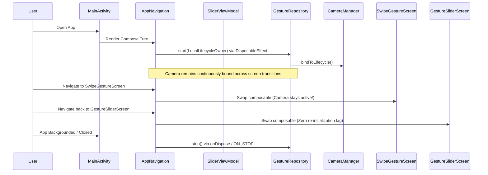

# Project Architecture Context — GestureSliderPoC

---

## 1. Executive Summary

**GestureSliderPoC** is an Android Proof-of-Concept exploring **touchless human-computer interaction (HCI)** using standard mobile hardware. By capturing live video through the front-facing camera, extracting 21 3D hand landmarks via **MediaPipe Tasks Vision**, and evaluating spatial kinematics in real-time, users can control UI components (such as an interactive slider and a 3x3 directional grid) entirely hands-free.

---

## 2. Core Technology Stack

- **Language:** Kotlin 2.0+ (targeting JVM 17)
- **UI Toolkit:** Jetpack Compose (BOM managed, Material 3)
- **Camera & Vision:** 
  - AndroidX CameraX (Core, Camera2, Lifecycle, View)
  - Google MediaPipe Tasks Vision (`hand_landmarker.task` running on GPU with CPU fallback)
- **Concurrency & Reactivity:** Kotlin Coroutines, `StateFlow`, `SharedFlow`, Channels with `DROP_OLDEST` backpressure
- **Dependency Injection:** Hilt (Dagger)
- **Architecture:** Multi-module Clean Architecture + MVVM + Unidirectional Data Flow (UDF)

---

## 3. End-to-End Pipeline Architecture

```mermaid
flowchart TD
    subgraph Camera["Camera Subsystem (CameraX)"]
        CamFront[Front Camera Sensor] --> ImgAnalysis[ImageAnalysis: STRATEGY_KEEP_ONLY_LATEST]
        CamFront --> CamPreview[Preview Use Case]
    end

    subgraph CoreEngine["Processing Engine (:gesture-core)"]
        ImgAnalysis --> Gate{Atomic Gate isProcessing?}
        Gate -- false --> HandHelper[HandLandmarkerHelper]
        Gate -- true --> Drop[imageProxy.close()]
        HandHelper --> MP[MediaPipe Live Stream]
        MP --> LandmarkMapper[LandmarkMapper: Invert X for Front Mirroring]
        LandmarkMapper --> LandmarksFlow[Raw Landmarks Flow]
        
        LandmarkMapper --> Detectors
        subgraph Detectors["Gesture Classification"]
            SwipeDet[SwipeDetector: Velocity & Delta Vector]
            PinchDet[PinchDetector: Euclidean Distance & Finger State]
        end
        Detectors --> GestureFlow[GestureState Flow]
    end

    subgraph Presentation["Presentation & UI (:ui)"]
        CamPreview --> PreviewLayer[CameraPreviewLayer: PreviewView]
        LandmarksFlow --> SkeletonOverlay[Canvas: 21 Landmarks + 21 Bones]
        GestureFlow --> VM[SliderViewModel: UDF State Machine]
        VM --> UIState[SliderUiState]
        UIState --> Screens["Screens: GestureSliderScreen / SwipeGestureScreen"]
    end
```

---

## 4. Detailed Data & Frame Flow

### 4.1 Frame Capture & Non-Blocking Gating
1. CameraX generates an `ImageProxy` (RGBA_8888) via `ImageAnalysis` running on a dedicated single-thread executor (`CameraManager`).
2. An `AtomicBoolean(isProcessing)` inspects if the previous frame is still being evaluated by MediaPipe.
3. If busy, `imageProxy.close()` is executed immediately, completely preventing memory leaks and frame buffer starvation.
4. If idle, `HandLandmarkerHelper.processFrame` transforms the image and queues inference asynchronously via `detectAsync`.

### 4.2 Landmark Mapping & Coordinate Spaces
- MediaPipe outputs 21 normalized landmarks (`[0.0, 1.0]`).
- Front cameras present a natural mirrored view to the user. `LandmarkMapper` inverses the X coordinate:
  $$\text{normalizedX} = 1.0 - \text{landmark.x}$$
- This guarantees that moving a hand to the user's physical right moves the screen cursor to the visual right.

### 4.3 Gesture Evaluation Hierarchy
Each processed frame delivers normalized landmarks to detectors:
1. **SwipeDetector:** Inspects wrist coordinate history over a tight sliding window ($50\text{ms} - 300\text{ms}$) with a $0.2f$ displacement threshold and $400\text{ms}$ debounce. If a swipe is detected, it takes immediate precedence.
2. **PinchDetector:** If no swipe occurred, evaluates Euclidean distance between thumb tip (`index 4`) and index tip (`index 8`).
   - $\text{distance} < \text{threshold}$: Transitions from `PinchClick` $\rightarrow$ `Dragging` (if held $\ge 300\text{ms}$) or `PinchDetected`.
   - Finger state classification: If index finger is extended and middle/ring/pinky are curled, transitions to `Pointing`.
   - No hand detected: Emits `NoHand`.

### 4.4 UI Layer Consumption
- `SliderViewModel` launches two independent coroutines collecting:
  - `rawLandmarkStream()` $\rightarrow$ Updates `rawLandmarks` in `SliderUiState` for 60 FPS skeletal drawing.
  - `gestureStateStream()` $\rightarrow$ Updates interaction state (`cursorMode`, `sliderValue`, `gridRow`, `gridCol`).
- The UI consumes a single immutable `SliderUiState` via `collectAsState()`.

---

## 5. Concurrency & Lifecycle Preservation Model


