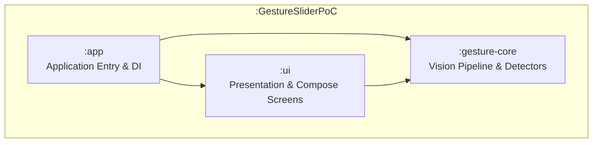

# Project Architecture Map — GestureSliderPoC

---

## 1. Module Architecture & Dependency Graph



- **`:gesture-core`**: Independent, pure Kotlin/Android vision library. No Compose dependencies.
- **`:ui`**: Pure Compose presentation layer. Depends on `:gesture-core` domain contracts.
- **`:app`**: Application orchestrator, Hilt dependency injection, Activity entry point.

---

## 2. Comprehensive File Directory & Component Map

### Module: `:gesture-core` (`com.gesture.slider.core`)
```
gesture-core/
├── build.gradle.kts
└── src/main/java/com/gesture/slider/core/
    ├── data/
    │   ├── camera/
    │   │   └── CameraManager.kt            # Wraps ProcessCameraProvider, Preview & ImageAnalysis
    │   ├── detector/
    │   │   ├── PinchDetector.kt            # Classifies PinchClick, Dragging, PinchDetected, Pointing
    │   │   └── SwipeDetector.kt            # Tracks wrist kinematics over time window for 4-way swipes
    │   ├── mediapipe/
    │   │   ├── HandLandmarkerHelper.kt     # MediaPipe Tasks Vision wrapper (detectAsync, GPU/CPU)
    │   │   └── LandmarkMapper.kt           # Transforms MediaPipe results to HandLandmark, handles mirroring
    │   └── repository/
    │       └── GestureRepositoryImpl.kt    # Glues camera frames to MediaPipe and detector outputs
    └── domain/
        ├── entity/
        │   ├── GestureNavConfig.kt         # Data config: thresholds, windows, confidence, model path
        │   ├── GestureState.kt             # Sealed class representing discrete gesture events
        │   ├── HandLandmark.kt             # Normalized (x, y, z) 3D coordinate point
        │   └── LandmarkIndex.kt            # Constant mapping of MediaPipe landmark IDs (0..20)
        └── repository/
            ├── GestureCoreFactory.kt       # Pure factory to create GestureRepository without DI coupling
            └── GestureRepository.kt        # Public interface contract for UI/consumers
```

### Module: `:ui` (`com.gesture.slider.ui`)
```
ui/
├── build.gradle.kts
└── src/main/java/com/gesture/slider/ui/
    ├── SliderUiState.kt                    # Single immutable state model for Compose
    ├── SliderViewModel.kt                  # State machine converting GestureState into UI state
    └── screen/
        ├── CameraPreviewLayer.kt           # AndroidView hosting PreviewView
        ├── GestureCursorOverlay.kt         # Real-time pointer/drag trail canvas overlay
        ├── GestureSliderContent.kt         # Slider value text, buttons, guides
        ├── GestureSliderScreen.kt          # 5-layer composite screen for slider demonstration
        ├── GestureSliderWidget.kt          # Custom Canvas-drawn touchless slider bar
        ├── GestureStatusLabel.kt           # Rounded pill displaying active gesture label
        └── SwipeGestureScreen.kt           # Live camera + skeleton overlay + 3x3 interactive grid
```

### Module: `:app` (`com.gesture.slider.poc`)
```
app/
├── build.gradle.kts
├── src/main/
│   ├── AndroidManifest.xml                 # Camera permissions and hardware feature declarations
│   └── java/com/gesture/slider/poc/
│       ├── GestureSliderApp.kt             # Application class annotated with @HiltAndroidApp
│       ├── MainActivity.kt                 # Permission flow & AppNavigation composable host
│       └── di/
│           └── AppModule.kt                # Hilt module providing GestureRepository & Config
```

---

## 3. Class Responsibilities Matrix

| Class / File | Module | Responsibility | Key Collaborators |
|---|---|---|---|
| `CameraManager` | `gesture-core` | Manages CameraX provider, binds lifecycle, exposes `Preview` use case | `ProcessCameraProvider`, `ImageAnalysis` |
| `HandLandmarkerHelper` | `gesture-core` | Configures MediaPipe vision tasks, executes asynchronous live frame detection | `HandLandmarker`, `MPImage` |
| `LandmarkMapper` | `gesture-core` | Flips front-camera X-axis coordinates and returns sanitized domain landmarks | `HandLandmark`, `HandLandmarkerResult` |
| `PinchDetector` | `gesture-core` | Evaluates index/thumb Euclidean distances, detects pinch clicks & drag deltas | `LandmarkIndex`, `GestureState` |
| `SwipeDetector` | `gesture-core` | Evaluates wrist velocity vectors ($dx/dy$) across time history buffer | `LandmarkIndex`, `GestureState.Swiping` |
| `GestureRepositoryImpl` | `gesture-core` | Orchestrates atomic frame processing, emits state and raw landmark flows | `CameraManager`, `HandLandmarkerHelper` |
| `SliderViewModel` | `ui` | Subscribes to repository flows, updates `SliderUiState`, handles grid coordinates | `GestureRepository`, `SliderUiState` |
| `AppNavigation` | `app` | Houses top-level `DisposableEffect` for Camera lifecycle and renders screens | `MainActivity`, `SliderViewModel` |
| `GestureSliderScreen` | `ui` | Coordinates preview, scrim, custom slider widget, cursor overlay, status label | `SliderUiState`, `CameraPreviewLayer` |
| `SwipeGestureScreen` | `ui` | Renders live camera feed, 21-point hand skeleton canvas, and 3x3 navigation grid | `HAND_CONNECTIONS`, `SliderUiState` |

---

## 4. Public API Boundaries

The only symbols exposed from `:gesture-core` to outside modules are:
1. `GestureRepository` (Interface)
2. `GestureCoreFactory` (Object Factory)
3. `GestureState` (Sealed Class)
4. `HandLandmark` (Data Class)
5. `GestureNavConfig` (Data Class)

All internal detectors (`PinchDetector`, `SwipeDetector`), helpers (`HandLandmarkerHelper`, `LandmarkMapper`), and managers (`CameraManager`, `GestureRepositoryImpl`) are strictly marked with Kotlin `internal` visibility.
