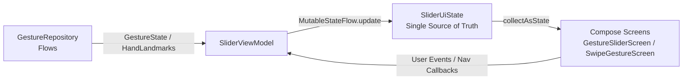

# Android MVVM Architecture Pattern Skill — GestureSliderPoC

---

## 1. Scope & Guidelines

This skill details how the **Model-View-ViewModel (MVVM)** architectural pattern is implemented in GestureSliderPoC using **Unidirectional Data Flow (UDF)**.

---

## 2. Unidirectional Data Flow (UDF) Loop



1. **Repository emits events:** `GestureRepository` emits discrete `GestureState` sealed instances and `List<HandLandmark>`.
2. **ViewModel processes & updates state:** `SliderViewModel` observes repository streams, applies business rules (clamping slider values, moving grid coordinates), and updates `_uiState`.
3. **UI passively observes:** Composables collect `uiState` via `viewModel.uiState.collectAsState()` and render the view.

---

## 3. Implementation Best Practices

### 3.1 Single Immutable UiState Model
All UI properties live inside one immutable data class `SliderUiState`:
```kotlin
data class SliderUiState(
    val sliderValue: Float = 0.5f,
    val cursorX: Float = 0f,
    val cursorY: Float = 0f,
    val cursorVisible: Boolean = false,
    val cursorMode: CursorMode = CursorMode.POINTER,
    val isDragging: Boolean = false,
    val clickPulse: Int = 0,
    val trailPoints: List<Pair<Float, Float>> = emptyList(),
    val gestureLabel: String = "Show your hand",
    val gridRow: Int = 1,
    val gridCol: Int = 1,
    val rawLandmarks: List<HandLandmark> = emptyList()
)
```

**Why single state over multiple StateFlows?**
- Eliminates inconsistent, torn states during rapid frame recompositions.
- Atomic updates: `_uiState.update { it.copy(...) }`.

### 3.2 StateFlow Exposure Pattern
Never expose `MutableStateFlow` directly to the UI. Always expose read-only `StateFlow`:
```kotlin
@HiltViewModel
class SliderViewModel @Inject constructor(
    val gestureRepository: GestureRepository
) : ViewModel() {

    private val _uiState = MutableStateFlow(SliderUiState())
    val uiState: StateFlow<SliderUiState> = _uiState.asStateFlow()
    ...
}
```

### 3.3 Atomic Updates with `update { }`
Never use direct assignment (`_uiState.value = ...`) in multi-threaded coroutine collectors. Always use `update`:
```kotlin
_uiState.update { current ->
    current.copy(
        gridRow = newRow,
        gridCol = newCol
    )
}
```

---

## 4. MVVM Anti-Patterns to Avoid

| Anti-Pattern | Correct Approach |
|---|---|
| Passing `Context` or Android views into `ViewModel` | Use repository abstractions or pass callbacks from Compose |
| Using `LiveData` in new code | Use Kotlin `StateFlow` / `SharedFlow` |
| Emitting one-off UI events via channels without consumption handling | Model ephemeral events as state counters (e.g., `clickPulse: Int`) |
| Doing math/transformations directly in Composable | Do transformations in `ViewModel` or dedicated detectors in `gesture-core` |
| Calling `launch` directly in Composable for state sync | Use `viewModelScope` inside ViewModel to sync with repository flows |
