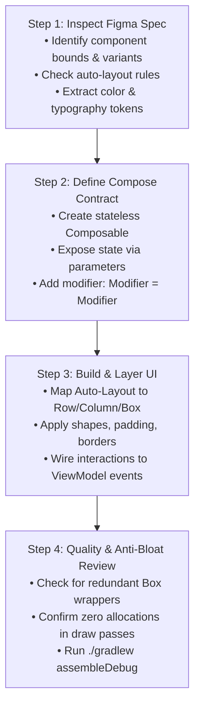

# Figma to Android Compose Skill (Figma Code Connect) — GestureSliderPoC

---

## 1. Scope & Purpose

This skill defines the process for transforming **Figma designs, component specs, and Figma Code Connect tokens** into production-ready, clean, high-performance **Jetpack Compose** code tailored to the **GestureSliderPoC** application.

---

## 2. Figma Code Connect Core Principles

When **Figma Code Connect** is active, Figma components map directly to connected Composable functions, properties, and design tokens rather than generating naive auto-generated UI code.

### Cardinal Translation Rules:
1. **Never Copy Raw Absolute Layouts:** Figma often exports absolute pixel positioning. Compose requires fluid layouts (`Row`, `Column`, `Box`, `Modifier.weight()`, `Arrangement.SpaceBetween`).
2. **Design Tokens Over Hardcoded Values:** Map Figma spacing, typography, and colors to Material Theme or shared constants:
   - Figma Spacing ($8\text{px}, 16\text{px}, 24\text{px}$) $\rightarrow$ `8.dp, 16.dp, 24.dp`.
   - Figma Typography (Font weight, size, line-height) $\rightarrow$ `MaterialTheme.typography` or explicit `TextStyle`.
   - Figma Colors $\rightarrow$ Semantic colors in Compose (`Color(0x...)` or theme-based).
3. **Keep Composables Modular & Recomposable:** Break down complex Figma frames into small, testable, reusable composables.
4. **Performance Hygiene (No Draw Allocations):** Custom drawn components from Figma (vectors, shapes, glow effects) must not allocate objects inside `Canvas { }` or `drawBehind { }`.

---

## 3. Mapping Matrix: Figma to Jetpack Compose

| Figma Concept | Jetpack Compose Equivalent | Code Connect Mapping Pattern |
|---|---|---|
| **Frame (Vertical Auto-Layout)** | `Column(verticalArrangement = ..., horizontalAlignment = ...)` | `layout = "vertical"` |
| **Frame (Horizontal Auto-Layout)** | `Row(horizontalArrangement = ..., verticalAlignment = ...)` | `layout = "horizontal"` |
| **Frame (Overlapping / Freeform)** | `Box(contentAlignment = ...)` | Stacked layers |
| **Component Variant / Property** | Composable parameter (e.g., `variant: ButtonVariant`) | Direct parameter mapping |
| **Vector / Complex Path** | `Canvas { drawPath(...) }` or `ImageVector` | Pre-parsed path |
| **Corner Radius / Stroke** | `Modifier.clip(RoundedCornerShape(...)).border(...)` | Direct modifier |
| **Drop Shadow / Elevation** | `Modifier.shadow(...)` or custom canvas glow | Scoped modifiers |
| **Opacity / Alpha** | `color.copy(alpha = ...)` or `Modifier.alpha(...)` | Modifier / Color |

---

## 4. Figma Code Connect Annotation & Declaration Template

When connecting Figma components to this project, follow this clean pattern in the `:ui` module:

```kotlin
package com.gesture.slider.ui.component

import androidx.compose.foundation.background
import androidx.compose.foundation.border
import androidx.compose.foundation.clickable
import androidx.compose.foundation.layout.Box
import androidx.compose.foundation.layout.padding
import androidx.compose.foundation.layout.size
import androidx.compose.foundation.shape.RoundedCornerShape
import androidx.compose.material3.Text
import androidx.compose.runtime.Composable
import androidx.compose.ui.Alignment
import androidx.compose.ui.Modifier
import androidx.compose.ui.graphics.Color
import androidx.compose.ui.text.font.FontWeight
import androidx.compose.ui.unit.Dp
import androidx.compose.ui.unit.dp
import androidx.compose.ui.unit.sp

/**
 * Connected Component: Figma "Interactive Grid Cell"
 * Figma Node ID: 124:582
 */
@Composable
fun FigmaGridCell(
    isSelected: Boolean,
    label: String,
    modifier: Modifier = Modifier,
    size: Dp = 80.dp,
    onClick: () -> Unit = {}
) {
    // 1. Resolve State Colors based on Figma Variant Properties
    val backgroundColor = if (isSelected) Color(0xFF4CAF50) else Color(0xFF2C2C2C)
    val borderColor = if (isSelected) Color.White else Color(0xFF555555)
    val textColor = if (isSelected) Color.Black else Color.White

    // 2. Compose Layout matching Figma Auto-Layout Spec
    Box(
        modifier = modifier
            .size(size)
            .clip(RoundedCornerShape(12.dp))
            .background(backgroundColor)
            .border(width = 2.dp, color = borderColor, shape = RoundedCornerShape(12.dp))
            .clickable(onClick = onClick)
            .padding(8.dp),
        contentAlignment = Alignment.Center
    ) {
        if (isSelected) {
            Text(
                text = label,
                color = textColor,
                fontSize = 20.sp,
                fontWeight = FontWeight.Bold
            )
        }
    }
}
```

---

## 5. 4-Step Figma-to-Compose Conversion Workflow



### Step 1: Inspect Figma Node
- Check if it uses **Auto-Layout**. Auto-layout translates cleanly to `Row` or `Column`.
- Identify fixed vs. hugging vs. filling dimensions (`Modifier.width()`, `Modifier.fillMaxWidth()`, or `Modifier.weight(1f)`).

### Step 2: Define the Stateless Composable API
- Always place reusable Figma components in `ui/src/main/java/com/gesture/slider/ui/component/` or `ui/.../screen/`.
- Ensure the Composable is **stateless**: receive values as parameters, emit events as lambdas.
- Always include `modifier: Modifier = Modifier` as the first optional parameter.

### Step 3: Map Layouts Cleanly
- Avoid nested redundant `Box` or `Column` wrappers. If a `Box` has only one child and no background or alignment, remove the wrapper.
- Use Compose built-in arrangements: `Arrangement.spacedBy(8.dp)`.

### Step 4: Validate Against Design System
- Test with Dark & Light backgrounds (especially important for our camera background layer).
- Ensure high contrast against the semi-transparent black camera scrim (`Color.Black.copy(alpha = 0.3f)`).
