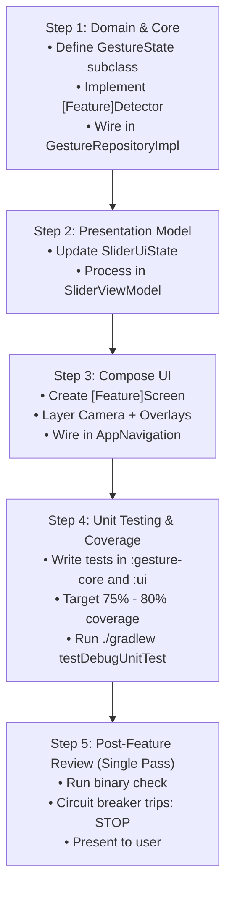

# New Feature Implementation Skill — GestureSliderPoC

---

## 1. Scope & Guidelines

This skill guides the implementation of any new feature in **GestureSliderPoC** (e.g., a new gesture type, a new interactive screen, or extended UI controls), enforces **writing unit tests with a 75%–80% coverage target**, and defines a **Post-Feature Review with an Anti-Churn Circuit Breaker** to prevent infinite re-execution loops.

---

## 2. Standard 5-Step Feature Workflow



### Step 1: Update Domain & Core Logic (`:gesture-core`)
1. If a new gesture type is required, add a subclass to `GestureState`:
   ```kotlin
   data class ThumbsUp(val confidence: Float) : GestureState()
   ```
2. Create an `internal` detector class under `data/detector/`:
   ```kotlin
   internal class ThumbsUpDetector {
       fun process(landmarks: List<HandLandmark>): GestureState? { ... }
   }
   ```
3. Instantiate and invoke it in `GestureRepositoryImpl.kt` within the frame results collector.

### Step 2: Update Presentation State & ViewModel (`:ui`)
1. Add new properties to `SliderUiState.kt` with sensible default values.
2. In `SliderViewModel.kt`, handle the new `GestureState` branch inside `processGesture(state)`.

### Step 3: Implement or Update Compose UI (`:ui`)
1. Create or extend the screen composable in `ui/src/main/java/com/gesture/slider/ui/screen/`.
2. Follow the standard 5-layer screen pattern (Camera $\rightarrow$ Canvas Overlay $\rightarrow$ Scrim $\rightarrow$ Controls $\rightarrow$ Status Pill).
3. Connect navigation in `AppNavigation` in `MainActivity.kt`.

### Step 4: Write Unit Tests & Target 75%–80% Coverage
1. For detectors: Add test methods in `gesture-core/src/test/java/...` covering threshold boundaries, empty landmark inputs, and kinematic progressions.
2. For ViewModels: Add test methods in `ui/src/test/java/...` using Turbine and `runTest` asserting state transitions.
3. Target **75% to 80% code coverage** for newly added code paths.
4. Execute test suite: `./gradlew testDebugUnitTest`. All tests must pass before review.

---

## 3. Post-Feature Review & Anti-Churn Circuit Breaker

> [!CAUTION]
> **Anti-Churn Mandate:** The review process must **never** become an infinite loop of recursive refactorings or speculative edits. Follow this strict circuit breaker:

### 🛑 Circuit Breaker Rules (Stop Mechanism)

1. **Strict Single-Pass Rule (Max 1 Pass):**
   - The review is conducted **exactly once** after tests pass.
   - If no critical defect (unclosed image proxy, draw-loop allocation, compilation error) is found, **immediately stop**. Do not search for cosmetic or speculative changes.

2. **The "Anti-Churn" Threshold (< 5 Lines):**
   - If an optimization only saves $< 5$ lines or is purely a stylistic preference, **leave it untouched**.
   - *"If it is working, simple, clean, and tested, it is finished."*

3. **Hard Ban on Re-Architecture During Review:**
   - The review may only remove dead variables/imports or fix a direct bug.
   - The review **MUST NEVER** create new classes, interfaces, or rewrite feature architecture.

4. **Deterministic Exit Gate ("Definition of Done"):**
   The review terminates immediately when:
   - [x] `./gradlew testDebugUnitTest` passes with zero failures.
   - [x] `./gradlew assembleDebug` compiles successfully.
   - [x] No object allocations inside `Canvas { }` or hot frame paths.
   - [x] Zero unused imports or dead variables.
   
   **ACTION ON PASS:** Stop calling tools immediately. Present the final result to the user.
