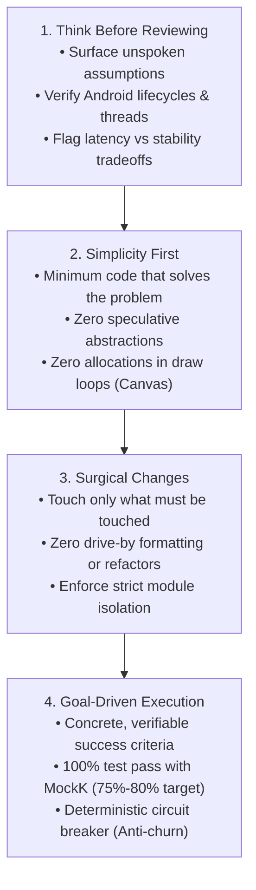
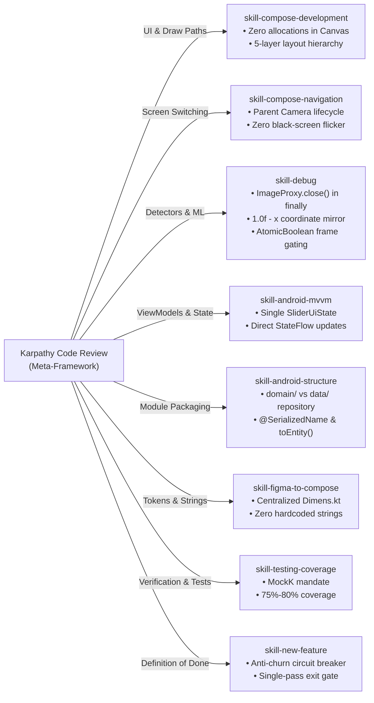

# Simplicity Code Review Skill — GestureSliderPoC

---

## 1. Scope & Purpose

This skill establishes a code review standard for **GestureSliderPoC** based on the four fundamental principles popularized by **Andrej Karpathy** (from open-source AI coding guidelines, including `andrej-karpathy-skills`). 

It directly addresses common software engineering and LLM pitfalls—such as silent assumptions, over-engineering, drive-by refactoring, and unverified completion—and maps them to Android best practices across **CameraX**, **Google MediaPipe**, **Jetpack Compose**, **Unidirectional Data Flow (UDF)**, and **MockK testing**.

---

## 2. The Four Karpathy Principles Applied to Android



---

## 3. Companion Skills Integration Matrix

The Karpathy Code Review Skill acts as the **orchestrating meta-skill**. It coordinates and invokes the project's specialized skill guidebooks according to the code layers under review:



| Affected Area in Diff | Companion Skill Guide | Specific Inspection Focus |
|---|---|---|
| **Composables & Overlays** | [`skill-compose-development`](file:///Users/rishabhmanikpuri/.gemini/antigravity/scratch/GestureSliderPoC/docs/skill-compose-development.md) | Ensure no objects (`Paint`, lists, paths) are allocated inside `Canvas { }` or draw loops. Enforce 5-layer screen structure. |
| **Navigation & Camera View** | [`skill-compose-navigation`](file:///Users/rishabhmanikpuri/.gemini/antigravity/scratch/GestureSliderPoC/docs/skill-compose-navigation.md) | Verify CameraX lifecycle is bound in parent container, preventing black frames during tab transitions. |
| **MediaPipe & Detectors** | [`skill-debug`](file:///Users/rishabhmanikpuri/.gemini/antigravity/scratch/GestureSliderPoC/docs/skill-debug.md) | Verify `imageProxy.close()` is in `finally`, front-camera coordinates are mirrored ($1f - x$), and CPU fallback is present. |
| **ViewModels & UI State** | [`skill-android-mvvm`](file:///Users/rishabhmanikpuri/.gemini/antigravity/scratch/GestureSliderPoC/docs/skill-android-mvvm.md) | Verify single immutable `SliderUiState`, direct StateFlow emission, and no abstract `BaseViewModel`. |
| **Layer Packaging & DTOs** | [`skill-android-structure`](file:///Users/rishabhmanikpuri/.gemini/antigravity/scratch/GestureSliderPoC/docs/skill-android-structure.md) | Ensure repository interfaces reside in `domain/repository/` and implementations in `data/repository/`. Enforce `@SerializedName` on DTOs. |
| **Tokens & Resources** | [`skill-figma-to-compose`](file:///Users/rishabhmanikpuri/.gemini/antigravity/scratch/GestureSliderPoC/docs/skill-figma-to-compose.md) | Enforce zero hardcoded text (use `strings.xml`) and zero raw dimensions (use centralized `Dimens.kt`). |
| **Unit Tests & Mocking** | [`skill-testing-coverage`](file:///Users/rishabhmanikpuri/.gemini/antigravity/scratch/GestureSliderPoC/docs/skill-testing-coverage.md) | Enforce MockK (`io.mockk:mockk`), Turbine flow tests, and 75%–80% coverage on new/modified logic. |
| **Review Termination** | [`skill-new-feature`](file:///Users/rishabhmanikpuri/.gemini/antigravity/scratch/GestureSliderPoC/docs/skill-new-feature.md) | Enforce single-pass review; suppress micro-churn $(< 5$ lines); trigger immediate deterministic exit on pass. |

---

## 4. Principle-by-Principle Review Standards

### 4.1 Principle 1: Think Before Coding / Reviewing
> **Karpathy Core:** *"Don't assume. Don't hide confusion. Surface tradeoffs."*

#### What to Check in Android / GestureSliderPoC:
1. **Thread Hopping & Lifecycle Safety:**
   - MediaPipe hand landmark inference and heavy matrix transformations must run on background dispatchers (`Dispatchers.Default` or dedicated executor). **Never run ML inference on Android's Main thread.**
   - CameraX `ImageProxy` frames must be closed in a `finally` block to prevent blocking the Camera2 buffer queue:
     ```kotlin
     // ✅ Karpathy Principle 1: Safe lifecycle handling
     try {
         val bitmap = imageProxy.toBitmap()
         helper.detectLiveStream(bitmap, isFrontCamera, timestamp)
     } finally {
         imageProxy.close() // Mandatory: prevents camera pipeline freeze
     }
     ```
2. **Coordinate Space & Mirroring Assumptions:**
   - Front-facing camera landmarks have inverted X coordinates ($X_{screen} = 1.0f - X_{raw}$). Ensure the code doesn't double-invert or assume rear-facing orientation.
3. **Surface Performance Tradeoffs Early:**
   - If smoothing algorithms (moving averages, Kalman filters) are introduced, explicitly evaluate the latency penalty versus gesture responsiveness before accepting the change.

---

### 4.2 Principle 2: Simplicity First
> **Karpathy Core:** *"Minimum code that solves the problem. Nothing speculative. If you write 200 lines and it could be 50, rewrite it."*

#### What to Check in Android / GestureSliderPoC:
1. **No "Junk Drawer" Utilities or Base Classes:**
   - Reject generic `GestureUtils`, `MathUtils`, or `BaseViewModel` abstractions.
   - Math and detector logic belong colocated inside the detector itself (`PinchDetector.kt`, `SwipeDetector.kt`).
2. **Zero Allocations in Hot Paths (30–60 FPS):**
   - MediaPipe and CameraX pipelines execute up to 60 frames per second. Reject any object allocation inside `Canvas { }`, `drawWithContent`, or `ImageAnalysis.Analyzer.analyze()`:
     ```kotlin
     // ❌ BAD: Allocation inside draw loop (triggers GC jank)
     Canvas(modifier = Modifier.fillMaxSize()) {
         val paint = Paint().apply { color = Color.Green } // Allocates every frame!
         drawCircle(color = Color.Green, radius = 20f, center = cursorOffset)
     }

     // ✅ GOOD: Zero allocation in draw pass
     Canvas(modifier = Modifier.fillMaxSize()) {
         drawCircle(color = primaryColor, radius = cursorRadiusPx, center = cursorOffset)
     }
     ```
3. **No Speculative Flexibility:**
   - Reject unused configuration flags, generic builders, or multi-layer `Result<T>`/`Resource<T>` wrappers. Keep state direct via `GestureState` and `SliderUiState`.
4. **Senior Engineer Simplicity Test:**
   - If a new feature can be cleanly implemented in 25 lines of standard Kotlin, reject implementations that introduce 80 lines of boilerplate abstractions.

---

### 4.3 Principle 3: Surgical Changes
> **Karpathy Core:** *"Touch only what you must. Clean up only your own mess. Every changed line should trace directly to the request."*

#### What to Check in Android / GestureSliderPoC:
1. **Zero Drive-By Refactoring:**
   - Diffs must not include unrelated code reformatting, renaming of untouched methods, or accidental whitespace shifts.
   - If pre-existing dead code is observed, log it as an issue—**do not touch or delete unrelated code in the feature PR**.
2. **Strict Module Boundary Isolation:**
   | Module | Permitted | Strictly Prohibited in Review |
   |---|---|---|
   | `:gesture-core` | CameraX, MediaPipe Tasks, pure Kotlin, Coroutines/Flow | Jetpack Compose, UI classes, ViewModels, Hilt annotations |
   | `:ui` | Jetpack Compose, Foundation, Material3, UI state | Direct MediaPipe classes, CameraX hardware management |
   | `:app` | Hilt DI modules, Activity navigation host | Feature domain logic, landmark calculation algorithms |
3. **Clean Up Orphans:**
   - If a modified function makes an import or private property obsolete, ensure that orphan is removed.
4. **Zero Hardcoding Mandate:**
   - All user-facing strings must reside in the module's `res/values/strings.xml`.
   - All dimensions (paddings, sizes, corner radii) must reference the centralized `Dimens.kt` / `dimens.xml`.

---

### 4.4 Principle 4: Goal-Driven Execution & Anti-Churn Circuit Breaker
> **Karpathy Core:** *"Define success criteria. Loop until verified. Never declare 'done' without proving it works."*

#### What to Check in Android / GestureSliderPoC:
1. **MockK Unit Testing Mandate:**
   - Every new detector, mapper, or ViewModel change must be accompanied by unit tests using **MockK** (`io.mockk:mockk`).
   - Must achieve **75% to 80% test coverage** on modified code paths.
   - Run verification command:
     ```bash
     ./gradlew testDebugUnitTest
     ```
   - **Zero failures permitted.**
2. **Build Integrity Verification:**
   - Build must succeed cleanly without breaking R8 or compilation:
     ```bash
     ./gradlew assembleDebug
     ```
3. **The Anti-Churn Circuit Breaker:**
   - **Single-Pass Review:** Review and remediate in a single pass. Do not cycle into recursive re-review iterations.
   - **The 5-Line Threshold:** If a proposed suggestion saves $< 5$ lines or is purely stylistic, leave working code untouched.
   - **Deterministic Exit:** When unit tests pass, compilation succeeds, and the checklist is satisfied, terminate review immediately.

---

## 5. Code Review Scoring Matrix

Use this rubric when assessing changes:

| Metric | Score: 1 (Fails Review) | Score: 2 (Needs Revision) | Score: 3 (Meets Karpathy Standard) |
|---|---|---|---|
| **Pillar 1: Think** | Assumptions unstated; Main thread blocked by ML; unclosed `ImageProxy`. | Lifecycles safe but tradeoffs not documented. | Threading explicit; `ImageProxy` closed; lifecycle scoped to parent Activity/Screen. |
| **Pillar 2: Simplicity** | Over-abstracted; custom `Result<T>` layers; allocations in `Canvas`. | Functional but verbose; unnecessary helper functions. | Minimal, concise Kotlin; zero draw-loop allocations; no speculative code. |
| **Pillar 3: Surgical** | Multi-file drive-by edits; module boundary violated; hardcoded strings. | Isolated diff but missed externalizing a string or dimension. | Surgical diff; strict module boundaries preserved; 100% strings/dimens externalized. |
| **Pillar 4: Goal-Driven** | No tests added; `./gradlew testDebugUnitTest` failing. | Tests present but MockK not used or coverage $< 75\%$. | 100% test pass; MockK utilized; 75%-80% coverage; clean single pass. |

---

## 6. Review Checklist (Definition of Done)

- [ ] **Karpathy Think:** Are all CameraX image proxies closed and ML inferences running on background threads?
- [ ] **Karpathy Simplicity:** Is the code free of speculative abstractions, junk-drawer utils, and allocations in draw loops?
- [ ] **Karpathy Surgical:** Is the diff strictly limited to the feature scope with zero drive-by reformatting?
- [ ] **Module Boundaries:** Are `:gesture-core`, `:ui`, and `:app` separation rules strictly obeyed?
- [ ] **Resource Externalization:** Are all user strings in `strings.xml` and dimensions in `Dimens.kt`?
- [ ] **MockK Coverage:** Are unit tests written with MockK targeting 75%–80% coverage?
- [ ] **Verification Execution:** Have `./gradlew testDebugUnitTest` and `./gradlew assembleDebug` passed with zero errors?
- [ ] **Circuit Breaker:** Has review stopped after a single pass without micro-churn?
